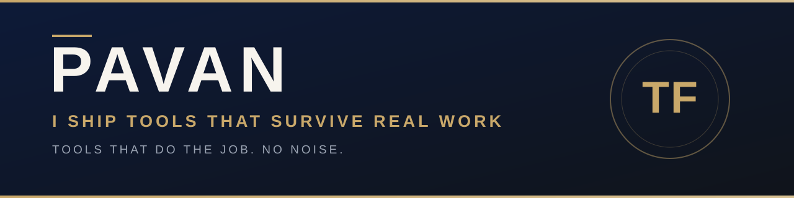

<em>Tools that do the job. No noise. Built for the people who run the work.</em>

Media ops specialist becoming an AI Forward Deployed Engineer. Messy workflow in, usable tool out. Building under [TapForge](https://tapforgehq.com).

🔨 **Now:** hardening VectraMail staging — auth + live proof — and prepping JobReport for TestFlight.

## ◆ Shipping now

**VectraMail** — outreach CRM, built like real SaaS: React + TypeScript, Express, Neon Postgres, Neon Managed Auth, Resend. Staging live on Render. Verification + JWT sign-in proven end-to-end. Private repo, under active development.

**TapForge** — tools for trades and small businesses, live on Gumroad: [Job Packet](https://tapforge.gumroad.com/l/job-packet) (job reports built on-site, sent from the phone), [Timeline → IRS Mileage Log](https://tapforge.gumroad.com/l/timeline-mileage-log) (Google Timeline → IRS-style log, parsed in the browser), plus an Apple Health PDF report tool and a short-form video system. Everything at [tapforgehq.com](https://tapforgehq.com).

**JobReport (iOS)** — SwiftUI + SwiftData. Offline-first job-photo reports for trades: before/after photos, signature, PDF out the door. Prototype compiled, running on device. TestFlight prep drafted.

## ◆ How I work

Account coordination, order management, subtitling pipelines for pooled theatrical clients. Client-facing, deadline-driven. I've seen too many good-looking tools die on contact with real work — so I build for the messy version first, and verify live before claiming anything.

Now: applied AI engineering — LLMs, agents, MCP, evals. Learning by shipping.

## ◆ Stack

## ◆ Find me

---

<em>Built under <a href="https://tapforgehq.com">TapForge</a> — tools that do the job.</em>

